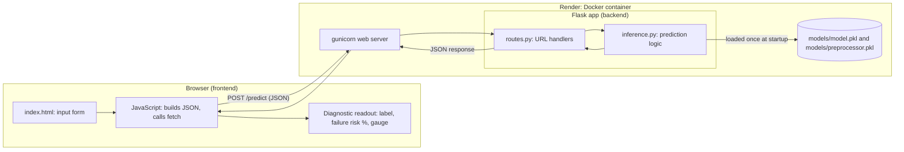
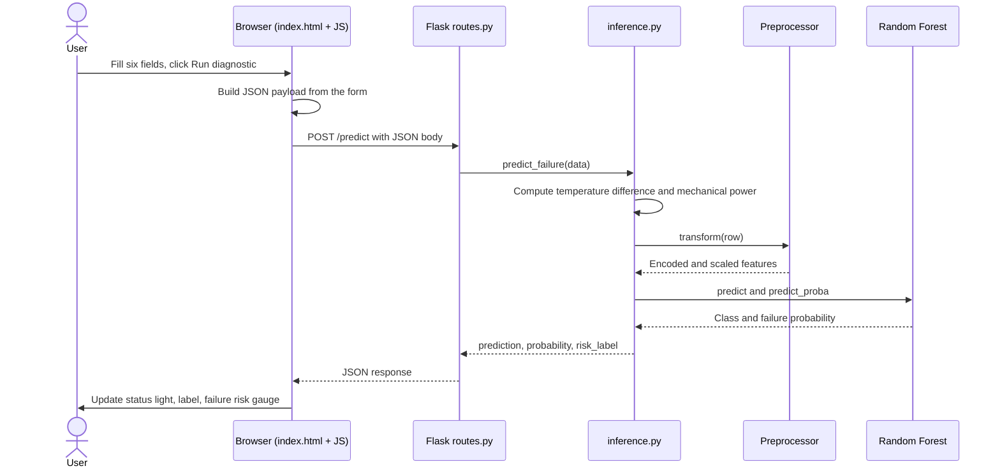
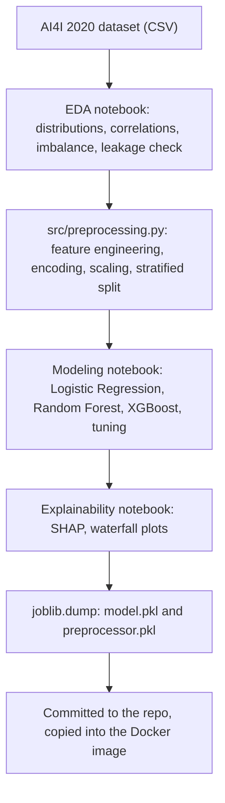

# Predictive Maintenance System

A web app that predicts whether an industrial machine is at risk of failing, using six sensor readings. It covers the full path from data analysis to a deployed service: EDA, modeling, explainability, a Flask backend, a browser frontend, and Docker deployment on Render.

**Live app:** https://predictive-maintance.onrender.com/

> The app runs on a free hosting tier that sleeps when idle. If nobody has opened it recently, the first page load can take 30 to 60 seconds while it wakes up.

---

## Who can use it and how it helps

| User | How they use it | What they gain |
|---|---|---|
| Maintenance technicians | Enter the readings from a machine's display and run a diagnostic | A fast second opinion on whether a machine needs attention, with no data science knowledge needed |
| Plant supervisors | Check several machines during a shift | A way to prioritize which machines to inspect first |
| Operations and planning managers | Use the failure risk percentage to compare machines | Earlier warning, so repairs can be scheduled before a breakdown stops production |
| Students and learners | Read the About page and explore the notebooks | A complete worked example of an ML project taken to deployment |
| Recruiters and engineers reviewing this portfolio | Open the live app and read this document | Evidence of the whole workflow: data work, modeling, API design, containerization, deployment |

Why it matters: unplanned machine failures stop production and cost money. A model that flags risky readings early lets a team replace worn tools or check a machine before it fails, instead of after.

---

## What the user sees

The interface has two pages.

- **Diagnostic tool (`/`)**: a form with six fields (machine type, air temperature, process temperature, rotational speed, torque, tool wear) and a readout panel. After submitting, the panel shows a status light, a **Normal** or **Failure Risk** label, and the failure risk as a percentage with a gauge.
- **About (`/about`)**: plain-language explanations of every input and of what the output means, written for someone with no technical background.

### Screenshots

**A healthy machine.** Inputs: type L, air 298.1 K, process 308.6 K, 1500 rpm, 42.3 Nm, 120 min of tool wear. The light is green, the label reads Normal, and failure risk is 0.0%.


**A machine at risk.** Inputs: type L, air 298.1 K, process 308.6 K, 1300 rpm, 70 Nm, 230 min of tool wear. The light is red, the label reads Failure Risk, and failure risk is 98.0%. The low speed, high torque, and heavy tool wear match the conditions that cause failures in the dataset.


**About page, inputs.** Each of the six readings is explained in plain language, including units.

![About page: input readings])

**About page, output.** Explains what the result and the failure risk percentage mean.


---

## Architecture

### System overview



### What happens when a user clicks "Run diagnostic"



### How the model was built (offline, before deployment)



---

## Backend, component by component

| Component | File | Responsibility |
|---|---|---|
| App factory | `app/__init__.py` | Creates the Flask app and registers the routes. gunicorn starts the app through this factory. |
| Routes | `app/routes.py` | Maps URLs to functions. `/` and `/about` render pages. `/predict` accepts JSON, calls the prediction function, and returns JSON. It contains no model logic. |
| Inference | `app/inference.py` | Loads the saved model and preprocessor once at startup. For each request it rebuilds the engineered features, applies the saved preprocessor, and returns the prediction. |
| Saved artifacts | `models/model.pkl`, `models/preprocessor.pkl` | The trained Random Forest and the fitted preprocessor (type encoding and scaling learned from the training data). |
| Web server | gunicorn (in the Dockerfile) | A production-grade server that runs the Flask app and listens on the port Render provides through `$PORT`. |
| Container | `Dockerfile`, `.dockerignore` | Packages the app and its dependencies so it runs the same way on a laptop and on Render. The ignore file keeps notebooks, raw data, and the virtual environment out of the image. |
| Hosting | Render | Builds the image from the `main` branch on GitHub and serves it over HTTPS. |

### Why the backend repeats two calculations

The preprocessor saved in `preprocessor.pkl` only scales and encodes columns. It does not know how to compute **temperature difference** (process minus air temperature) or **mechanical power** (torque x speed x 2 pi / 60). Those were created with pandas during training. So `inference.py` recomputes them from the six raw inputs before calling the preprocessor. The formulas must match `src/preprocessing.py` exactly.

### Why the preprocessor is loaded, not re-fitted

The scaler stores the mean and standard deviation it learned from the training data. Re-fitting on a single incoming row would scale it against itself and give meaningless numbers. Loading the saved preprocessor guarantees the app transforms input the same way the model was trained.

---

## Frontend and backend communication

The frontend never reads the model or the data. It only talks to one endpoint.

**Request:** `POST /predict` with a JSON body. The keys must match the training column names exactly.

```json
{
  "Type": "M",
  "Air temperature [K]": 300.0,
  "Process temperature [K]": 310.0,
  "Rotational speed [rpm]": 1500,
  "Torque [Nm]": 40.0,
  "Tool wear [min]": 100
}
```

**Response:** JSON with three fields (values below are illustrative).

```json
{
  "prediction": 0,
  "probability": 0.0312,
  "risk_label": "NORMAL"
}
```

| Field | Meaning |
|---|---|
| `prediction` | `0` for normal, `1` for failure risk |
| `probability` | Model's probability of failure, between 0 and 1. The page shows it as a percentage. |
| `risk_label` | `NORMAL` or `FAILURE RISK`, shown next to the status light |

Because the endpoint accepts and returns JSON, other tools (scripts, a mobile app, another service) can call it the same way the web page does.

---

## Model summary

- **Data:** AI4I 2020 Predictive Maintenance Dataset (UCI), 10,000 records, failures about 3.4% of the data.
- **Leakage prevention:** the five failure-mode columns (TWF, HDF, PWF, OSF, RNF) are components of the target, so they were removed from the features.
- **Features:** six raw inputs plus temperature difference and mechanical power.
- **Preprocessing:** ordinal encoding for machine type, standard scaling for numeric features, fit on training data only, stratified 80/20 split.
- **Imbalance:** class weighting.
- **Models compared:** Logistic Regression, Random Forest, XGBoost (tuned with RandomizedSearchCV). Random Forest was chosen for fewer false alarms and higher cross-validated F1.

### Results on the held-out test set (2,000 records)

| Metric | Failure class |
|---|---|
| Precision | 0.90 |
| Recall | 0.78 |
| F1 | 0.83 |

53 failures caught, 15 missed, 6 false alarms, 1,926 normal records correctly passed.

### Explainability

SHAP ranks mechanical power, tool wear, rotational speed, torque, and temperature difference as the main drivers. These match the failure rules in the dataset, which were verified separately against the raw data. That supports the conclusion that the model learned the physical failure mechanisms and not noise.

---

## Limitations

- The dataset is synthetic, so performance on real machines would need validation with real sensor data.
- The app uses the default 0.5 decision threshold. A lower threshold would catch more failures at the cost of more false alarms.
- A separate multi-label experiment predicted heat dissipation and power failures well, but scored zero on tool wear failures (very few test examples, partly random) and random failures (random by construction).
- The tool supports maintenance decisions and is not a certified safety device.
- Load and response-time testing has not been done.

---

## Run it yourself

Locally:

```bash
pip install -r requirements.txt
python run.py
```

With Docker:

```bash
docker build -t predictive-maintenance .
docker run -p 5000:5000 -e PORT=5000 predictive-maintenance
```

Then open http://localhost:5000.

---

## Project structure

```
docs/
  screenshots/       app screenshots used in this README
app/
  __init__.py        app factory
  routes.py          URL handlers (/, /about, /predict)
  inference.py       loads model, computes features, predicts
  templates/
    index.html       diagnostic tool page
    about.html       plain-language guide
models/
  model.pkl          trained Random Forest
  preprocessor.pkl   fitted encoder and scaler
src/
  preprocessing.py   shared preprocessing used in training
notebooks/           EDA, modeling, explainability
run.py               local entry point
Dockerfile           container build
requirements.txt     pinned dependencies
```

---

## Tech stack

Python, pandas, NumPy, scikit-learn, XGBoost, SHAP, Flask, Jinja, JavaScript (fetch API), gunicorn, Docker, Render, Git and GitHub.
